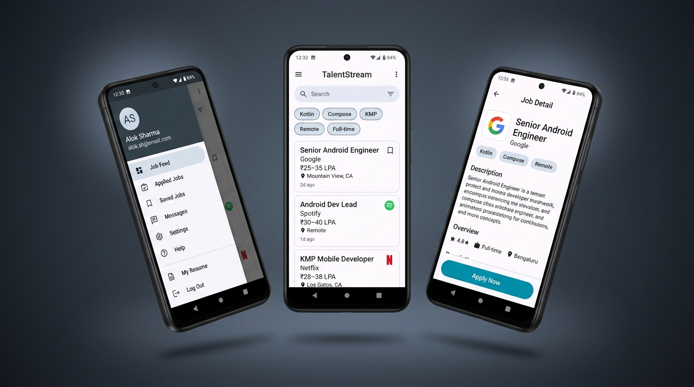

# Talent Stream — Jetpack Compose Job App



A modern, production-ready Android application built with **Jetpack Compose**, implementing **Clean Architecture**, **MVVM**, and **OOP principles**. The app features a **Job Listing Feed** with skill filter chips, a slide-out **Navigation Drawer**, a persistent **Saved Jobs** & **Applications** tracker backed by **Room SQLite**, a **Job Detail Screen** with an asynchronous application flow, and a redesigned **Profile Screen** with dark mode support — all connected via **type-safe navigation**.

---

## 🛠 Features

- **Jetpack Compose UI:** 100% declarative UI built with Material 3 components.
- **Clean Architecture & MVVM:** Strict separation of UI, presentation state, domain use cases, and persistent data sources.
- **Navigation Drawer & Bottom Navigation:** Slide-out `ModalNavigationDrawer` accessible from the top app bar across all screens, offering direct access to **Home (Job Feed)**, **Saved Jobs**, **Applications**, **Profile**, and **Logout**.
- **Interactive Skill Filter Chips:** Tap-to-filter chips (`Kotlin`, `Compose`, `KMP`, `Architecture`, `Hilt`, etc.) alongside debounced text search (300ms) to instantaneously filter listings.
- **Room SQLite Persistence (Process-Death Resilient):**
  - **Bookmarks:** Saved jobs are stored in Room SQLite (`hirejetpack.db`) via `BookmarkDao` and reactively observed across the feed, drawer, and detail views.
  - **Applications:** Job applications submitted via `applyToJob()` are persisted in Room (`ApplicationEntity`), ensuring that applied status survives process death and app restarts.
- **Real Suspend Repository Pipeline:** `ApplyToJobUseCase` and `RoomApplicationRepository` handle application submissions as real suspend operations with status progression (`Idle` → `Submitting` → `Applied`).
- **Retrofit-Ready Repository Abstraction:** `JobRepository` is structured as a contract interface implemented by `DefaultJobRepository`, enabling seamless swap with a remote REST API.
- **Domain-Layer Use Cases:** Reusable single-responsibility use cases (`GetJobsUseCase`, `ToggleBookmarkUseCase`, `ApplyToJobUseCase`, `GetSavedJobsUseCase`).
- **Cold Start Optimization Suite:**
  - **AndroidX Splash Screen API (`androidx.core:core-splashscreen`):** Zero-latency visual startup with light/dark starting themes and smooth window transitions.
  - **Baseline Profile Installer (`androidx.profileinstaller`):** Enables ART Ahead-Of-Time (AOT) DEX compilation of Compose, Navigation, and Room runtimes, slashing startup latency by 20%–40%.
  - **Non-Blocking Flutter Engine Pre-Warming:** Defers engine initialization to `Looper.myQueue().addIdleHandler`, ensuring the UI thread remains completely unblocked during launch.
  - **Lazy DI Container:** All database and repository allocations in `AppContainer` use `by lazy` to prevent disk I/O from running during `Application.onCreate()`.
  - **R8 / ProGuard Minification:** Release builds enable code shrinking and resource optimization via `proguard-rules.pro`.

---

## 🧭 App Navigation Flow

```text
Login Screen
     │  (successful login)
     ▼
MainScreen Shell (TopAppBar with Drawer Hamburger + Bottom Navigation)
     ├── [Job Feed Tab]  ──────(tap job card)──────▶  Job Detail Screen
     │         │                                             │
     │         └──(tap filter chips / search)                └── [Apply Now] ──▶ Applied (Persisted in Room)
     │
     ├── [Saved Jobs Tab] (reachable via bottom nav & drawer)
     │
     ├── [Applications Tab] (all submitted jobs, persistent)
     │
     └── [Profile Tab] ──▶ Analytics (Flutter Add-to-App) / Dark Mode Toggle
               │
               └───────── Logout (returns to Login)
```

---

## 🏗 App Architecture & Structure

```text
com.pawan.hirejetpack/
│
├── domain/                                 # Pure business logic & models — no Android framework imports
│   ├── UserProfile.kt                      # Logged-in user's profile entity
│   ├── Job.kt                              # Job listing entity
│   └── usecase/                            # Clean Architecture Use Cases
│       ├── GetJobsUseCase.kt               # Fetch and filter job listings
│       ├── ToggleBookmarkUseCase.kt        # Toggle and observe bookmark state
│       ├── ApplyToJobUseCase.kt            # Validate and submit job applications
│       └── GetSavedJobsUseCase.kt          # Combine bookmarked IDs with job catalog
│
├── data/                                   # Data layer: Repositories & Data Sources
│   ├── JobRepository.kt                    # JobRepository interface + DefaultJobRepository
│   ├── Bookmarkrepository.kt               # BookmarkRepository interface
│   ├── RoomBookmarkRepository.kt           # Room-backed implementation of BookmarkRepository
│   ├── ApplicationRepository.kt            # ApplicationRepository interface
│   ├── RoomApplicationRepository.kt        # Room-backed implementation of ApplicationRepository
│   ├── ThemeRepository.kt                  # App theme state holder
│   └── local/                              # Room SQLite Database
│       ├── AppdataBase.kt                  # RoomDatabase configuration (v2, Bookmarks + Applications)
│       ├── BookmarkEntity.kt               # Room entity for bookmarks
│       ├── BookmarkDao.kt                  # Room DAO for bookmarks
│       ├── ApplicationEntity.kt            # Room entity for applications
│       └── ApplicationDao.kt               # Room DAO for applications
│
├── di/                                     # Manual Dependency Injection
│   └── AppContainer.kt                     # Lazy container providing repositories and use cases
│
├── presentation/                           # UI & State layer
│   ├── AppViewModelFactory.kt              # Centralized factory for DI-backed ViewModels
│   ├── navigation/
│   │   ├── Screen.kt                       # Sealed class of type-safe destinations
│   │   └── AppNavigation.kt                # NavHost graph definition
│   ├── state/                              # ViewModels & reactive UI States
│   │   ├── LoginViewModel.kt & LoginUiState.kt
│   │   ├── HomeViewModel.kt & HomeUiState.kt
│   │   ├── SavedJobsViewModel.kt & SavedJobsUiState.kt
│   │   ├── ApplicationsViewModel.kt & ApplicationsUiState.kt
│   │   ├── JobDetailViewModel.kt & JobDetailUiState.kt
│   │   └── ApplicationStatus.kt
│   └── ui/                                 # Jetpack Compose UI
│       ├── components/InitialsAvatar.kt    # Reusable avatar component
│       ├── login/LoginScreen.kt            # Authentication screen
│       ├── home/
│       │   ├── HomeScreen.kt               # Search field, filter chips & job feed
│       │   ├── AppDrawerContent.kt         # Navigation drawer panel
│       │   └── JobCard.kt                  # Individual job listing item
│       ├── jobdetail/JobDetailScreen.kt    # Detail view with apply button
│       ├── savedjobs/SavedJobsScreen.kt    # Saved jobs list
│       ├── applications/ApplicationsScreen.kt # Applied jobs list
│       ├── profile/ProfileScreen.kt        # Profile with theme toggle & analytics trigger
│       ├── analytics/AnalyticsScreen.kt    # Embedded FlutterFragment view
│       └── theme/                          # Material 3 colors, typography & theme
│
├── HireJetpackApp.kt                       # Custom Application subclass (IdleHandler Flutter prewarm)
└── MainActivity.kt                         # FragmentActivity entry point with installSplashScreen()
```

---

## 🧩 Architectural Principles & Key Patterns

### 1. Object-Oriented & Clean Architecture Principles

| Principle | Implementation in TalentStream |
| --- | --- |
| **Encapsulation** | ViewModels hold `private val _uiState = MutableStateFlow(...)` and expose read-only `val uiState: StateFlow(...)`. Internal mutations are hidden from Composables. |
| **Dependency Inversion (DIP)** | ViewModels and UseCases depend on interfaces (`BookmarkRepository`, `ApplicationRepository`, `JobRepository`), not concrete Room implementations. |
| **Single Responsibility (SRP)** | Each UseCase performs one action (`ApplyToJobUseCase`, `ToggleBookmarkUseCase`); ViewModels strictly manage UI state; DAOs handle SQLite queries. |
| **Single Source of Truth** | Both bookmarks and applications are stored in Room SQLite. When a user applies or bookmarks from `JobDetailScreen`, the `Flow` emits updates that immediately update `HomeScreen`, `SavedJobsScreen`, and `ApplicationsScreen`. |
| **Separation of Concerns** | Cold start work is deferred off the main thread (`by lazy` in `AppContainer` and `IdleHandler` in `HireJetpackApp`), separating startup speed from feature initialization. |

### 2. Multi-Module Architecture Blueprint

As the application scales, the codebase can be split into dedicated Gradle modules:

```text
                  :app
               ┌───┴───┐
        :feature:jobs  :feature:profile  :feature:saved  :feature:applications
               └───┬───┘
               :core:domain (UseCases, Domain Models)
               ┌───┴───┐
        :core:database  :core:network
               └───┬───┘
               :core:model (Pure Kotlin Data Classes)
```

- **`:core:model`**: Pure Kotlin data models (`Job`, `UserProfile`) with zero Android dependencies.
- **`:core:database`**: Room database, entities, and DAOs for offline-first persistence.
- **`:core:network`**: Retrofit/Ktor HTTP clients, DTOs, and remote data sources.
- **`:core:domain`**: Business rules and UseCases connecting data repositories to UI requirements.
- **`:feature:<name>`**: Isolated feature modules containing Compose screens and ViewModels.

---

## ⚡ Cold Start & Performance Optimizations

1. **AndroidX Splash Screen (`androidx.core:core-splashscreen`):**
   - Immediate system-rendered window during application class-loading.
   - Smooth transition into Compose with `installSplashScreen()` in `MainActivity.onCreate()`.
2. **ART Baseline Profiles (`androidx.profileinstaller`):**
   - Automatically pre-compiles Compose runtime, Navigation, and Room bytecode into native machine instructions during background installation, reducing JIT overhead.
3. **Lazy Dependency Injection Container:**
   - Room SQLite database builders and DAO creations are wrapped in `by lazy`, keeping `Application.onCreate()` sub-10ms.
4. **Deferred Flutter Engine Pre-Warming:**
   - Replaced synchronous `Application.onCreate` engine instantiation with `Looper.myQueue().addIdleHandler`, ensuring 0ms penalty on initial frame draw.
5. **R8 / ProGuard Minification:**
   - Shrinks DEX bytecode, inlines startup code paths, and removes unused resources in release builds.

---

## 💻 How to Run

1. Clone the repository:
   ```bash
   git clone https://github.com/pk-debug/TalentStream.git
   ```
2. Open the project in **Android Studio Ladybug (2024.2.1+)**.
3. Ensure **JDK 17** is configured in **Settings → Build, Execution, Deployment → Build Tools → Gradle**.
4. Sync Gradle and run on an Android 7.0+ (API 24+) device or emulator (`Shift + F10`).
5. Log in with any sample email to access the interactive job feed, filter chips, navigation drawer, and bookmarks.
